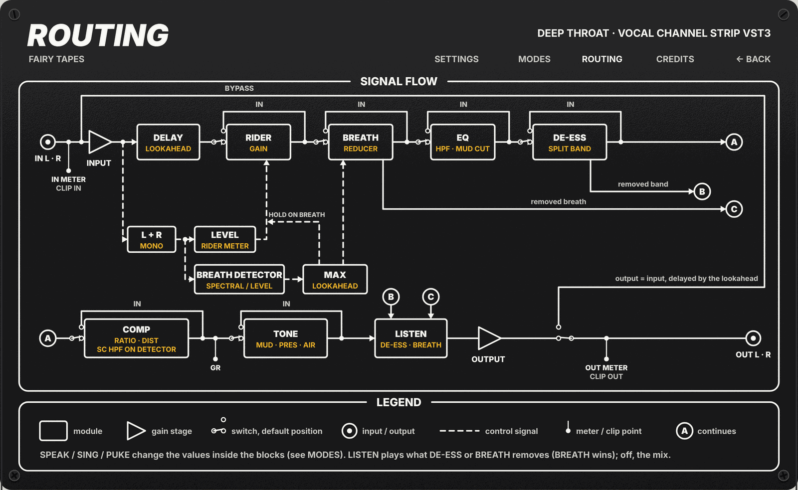

# Fairy Tapes · Deep Throat

Deep Throat is a VST3 channel strip for a single voice track. It evens out the level, turns breaths down, cleans up rumble, mud and harsh resonances, tames sibilance, compresses and adds a last touch of tone. The chain is fixed and there are few controls: put it on the vocal track, pick a mode (Speak, Sing or Puke) and adjust the knobs. Input and output are stereo; mono in to mono out also works.

**Status:** audio engine and editor are finished and their tests pass on Linux (2026-10-31). Not verified yet: tuning on real voices (every threshold is set on synthetic signals), colours and the panel flip inside a real host, and the Windows and macOS builds (CI builds them on merge to `master`).

## When to use it

- **Speak:** spoken word. Podcast hosts and guests, voice-over, narration, interviews. The Rider works hardest here (up to ±6 dB), the compressor is gentle (2:1, clean) and the Tone knob adds presence.
- **Sing:** sung vocals, lead or backing. The Rider is slower and smaller (up to ±4 dB), the compressor runs at 3:1 with even-harmonic colour (Dist 2) and the Tone knob adds air.
- **Puke:** extreme vocals such as screams and growls. These are noisy and have no clear pitch, so breath detection works on level only. The Rider barely moves (up to ±3 dB), the de-esser is almost off, the compressor is heavy (8:1, odd-harmonic Dist 3) and the Tone knob cuts mud while keeping the mids.

In every mode you can switch single modules off with their IN button, and use Breath Listen or De-ess Listen to hear exactly what is being removed.

## Signal flow



In engine order:

1. **Input** sets the level going into the chain.
2. **Detection** runs on the live signal after Input, summed to mono (L+R)/2: a level meter for the Rider and the breath detector of the current mode.
3. **Look-ahead delay.** The audio waits about 100 ms so the breath detector can see a breath before it reaches the reducer.
4. **Rider** rides the vocal level toward a target. It holds still during breaths and silence.
5. **Breath control** turns breaths down.
6. **Corrective EQ** removes rumble, cuts mud at 300 Hz and notches a ringing resonance.
7. **De-esser** turns down the sibilant band only.
8. **Compressor** with optional harmonic distortion and parallel Mix.
9. **Tone** is one knob for warmth, presence and air.
10. **Listen** (when on) replaces the chain output with what the de-esser or the breath reducer removes.
11. **Output** sets the final level.

Bypass replaces everything with the input, delayed by the same latency.

### The blocks in detail

- **Rider:** automatic level rider. It works on level only (200 ms RMS window), never on pitch. It moves the gain toward the Target by at most ±Range dB, with a limited slope. It holds still where Breath control detects a breath and when the level is below -60 dB.
- **Breath control:** a breath reducer, not a gate. It lowers the signal by up to 12 dB × Amount (attack 5 ms, release 30 ms), in proportion to the breath probability. The detector works on the mono sum (L+R)/2, so both channels get the same gain. Speak and Sing use a spectral detector. Puke uses a level detector (no spectral analysis, because growls and screams are noisy and have no pitch).
- **Puke detector details:** the 300 ms voice context is needed only to enter a breath, not to stay in it, so long breaths are reduced to their end within limits (see Known limits: past about 0.7 to 0.8 s the 2 s decay of the phrase tracker releases them before the cap). A quiet passage is treated as a breath for at most 1.5 s. After that, the same passage is no longer reduced until the voice comes back: a level close to the previous scream, or a rise of at least 8 dB above the passage (so a voice quieter than the scream also counts).
- **Corrective EQ:** high-pass (12 dB/oct), mud cut at 300 Hz (Q 1) and a dynamic notch (Q 8) that follows the most prominent persistent resonance between 1 and 6 kHz. The notch goes down to 6 dB at the default EQ Amount (12 dB at 100%). EQ Amount scales all three.
- **De-esser:** split band. Linkwitz-Riley crossover at Freq, linked mono detector. It reduces the high band only (4:1, up to 12 dB × Amount).
- **Compressor:** a compressor with program-dependent release and two distortion modes. Feed-forward, with a logarithmic detector and a high-pass on the detector only. 6 dB soft knee, times tied to the ratio, distortion that grows with gain reduction and with a fast attack, parallel Mix. In Dist 3 only the added distortion products are band-limited (30 Hz to 12 kHz), not the signal: with no reduction the response stays flat. Its character is inspired by the Distressor, a hardware compressor by Empirical Labs. Deep Throat does not model that circuit and is not affiliated with or endorsed by Empirical Labs.
- **Tone:** one knob over three filters (mud 250 Hz, presence 3.5 kHz, air shelf 12 kHz), with a curve per mode. 50% is neutral.

With its IN off a module passes the signal through (latency unchanged). Every module keeps running in the background, so switching it back on does not jump. IN, Bypass and both Listen switches crossfade over 5 ms.

## Modes

The mode sets internal values across the whole chain:

| Block | Speak | Sing | Puke |
|---|---|---|---|
| Breath detector | spectral | spectral | level |
| Rider (max range, slope) | ±6 dB, 8 dB/s | ±4 dB, 4 dB/s | ±3 dB, 2 dB/s |
| EQ: high-pass, cut at 300 Hz | 80 Hz, -2 dB | 70 Hz, -3 dB | 60 Hz, -4 dB |
| De-esser | normal | normal | Amount × 0.15 |
| Compressor (AUTO) | 2:1, no distortion | 3:1, Dist 2 | 8:1, Dist 3 |
| Tone | more presence | more air | cuts mud, keeps the mids |

The EQ values are those at the default EQ Amount (50%).

## Controls

25 parameters, all automatable. Normalized values are 0 to 1.

| Name | Range | Default | What it does |
|---|---|---|---|
| Bypass | on/off | off | Outputs the delayed input (latency unchanged) |
| Mode | Speak / Sing / Puke | Speak | Picks the internal values and the breath detector |
| Input | -12 to +12 dB | 0 dB | Input gain |
| Rider Target | -30 to -10 dBFS | -20 dBFS | Level the Rider moves the voice toward |
| Rider Range | 0 to 100% of the mode's maximum | 50% | Maximum Rider movement |
| Breath | 0 to 100% | 50% | Breath reduction, up to 12 dB |
| Breath Sensitivity | 0 to 100% | 50% | Higher = also detects fainter breaths |
| Breath Listen | on/off | off | Plays only what the breath reducer removes |
| EQ Amount | 0 to 100% | 50% | Scales the high-pass (× (0.5 + Amount)), the mud cut and the notch (× 2·Amount); 0 = cut and notch off |
| De-ess | 0 to 100% | 50% | Maximum reduction 12 dB × Amount |
| De-ess Freq | 4 to 10 kHz (log) | 6.5 kHz | Crossover and detector frequency |
| De-ess Listen | on/off | off | Plays only the band the de-esser removes |
| Compressor | 0 to 100% | 50% | Threshold -6 - 24·Amount dBFS, with makeup gain |
| Comp Mix | 0 to 100% | 100% | Parallel compression: 0 = only the compressor's input signal |
| Comp Ratio | AUTO, 2, 3, 4, 6, 8, 10, 20 :1 | AUTO | AUTO uses the mode's value |
| Comp Dist | AUTO, OFF, Dist 2, Dist 3 | AUTO | Even (Dist 2) or odd (Dist 3) harmonics; AUTO uses the mode's value |
| Comp SC HPF | OFF, 80 Hz, 150 Hz | 80 Hz | High-pass on the detector only |
| Tone | 0 to 100% | 50% | Neutral at the centre; below = warmer, above = more presence or air |
| Output | -12 to +12 dB | 0 dB | Output gain |
| Rider In | on/off | on | Includes the module |
| Breath In | on/off | on | Includes the module |
| EQ In | on/off | on | Includes the module |
| De-ess In | on/off | on | Includes the module |
| Comp In | on/off | on | Includes the module |
| Tone In | on/off | on | Includes the module |

Breath Listen takes precedence over De-ess Listen. Breath Listen also works with Breath In off (you hear what the reducer would remove).

## Latency

80 ms of look-ahead plus one frame of the spectral detector (`nextPow2(20 ms · sample rate)` samples): about 101 ms at 48 kHz. It is the same in every mode (in Puke the level detector has zero latency and simply gets more look-ahead). The plug-in reports it to the host, which compensates. Bypass and the IN buttons do not change it. A sample-rate change changes the latency, and the host reads it again after `setupProcessing` (there is no restart notification).

Because of the latency, Deep Throat suits mixing and post-production better than live monitoring.

## Editor

The editor opens from the host like any VST3 editor. It is 1000 × 614, fixed size, scaled by the host's scale factor.

- **Front:** one control for each of the 25 parameters. On a knob, double-click sets the default value; click the printed value to type one (Enter confirms, Esc cancels). The stepped controls (Mode, Ratio, Dist, SC HPF) always show the step the DSP uses, even when the host sends a value between steps. A module with IN off dims its controls and labels (its Listen too). Bypass dims everything except its own button, the IN and OUT rows of LEVEL, the clip LEDs and the labels of the header, LEVEL and MODE. Read-only labels show what the mode does: detector, mode description, `MAX ±`, HPF and MUD CUT, the three Tone dB values, and Ratio and Dist in AUTO.
- **LEVEL:** input and output peaks, compressor gain reduction (GR), and clip LEDs held for 2 s (a click clears them).
- **SCOPE:** about 8.8 s of voice envelope, Rider gain and the band of detected breaths. The BREATH lamp and the breath band go dark with Breath IN off or with Bypass. The GR row empties under Bypass.
- **Wear, tapes and screws:** generated from a seed saved with the plug-in instance. Click a tape to write on it (at most 14 characters). Drag a screw to turn it. Texts and angles are saved with the project.
- **Back:** the **BACK →** link at the top right flips the panel. Tabs: **SETTINGS** (APPEARANCE: Wear Off/Light/Heavy, tape font, values font, RE-ROLL for a new instance seed; NOTES), **MODES** (the values each mode sets, active column in yellow), **ROUTING** (the signal flow shown above), **CREDITS** (version, licence, third-party components). **← BACK** returns to the front.
- **Preferences:** the APPEARANCE choices apply per user, in every project (see Technical notes for the file).

## Known limits

- **Thresholds are tuned on synthetic signals**, not on real voices, and least of all on growls and screams. They need retuning with reference recordings (spec §9).
- **Breath detection:**
  - the start of a breath is recognised with a delay of about 60 to 80 ms (minimum duration). In Puke the reduction starts about 30 ms after the breath starts. In Speak and Sing it starts about 25 ms before and can touch the tail of the previous phrase;
  - the first breath of a take is not detected (the detectors need phrase context);
  - sibilants against breaths: not tested on real voice;
  - in Puke a quiet passage after a scream is reduced like a breath for at most 1.5 s;
  - a breath 25 dB deep stays reduced to its end only up to about 0.7 to 0.8 s. Past that, the 2 s decay of the phrase tracker releases it before the cap;
  - after a mode change that switches detector, the new detector needs a few hundred ms of phrase before it detects again;
  - the reducer's 30 ms release leaves about 4 dB of reduction 25 ms after the breath ends, so on the start of the next phrase.
- **Corrective EQ:** a perfectly steady held tone can trigger the notch after 300 ms (maximum depth 6 dB × 2·EQ Amount).
- **Compressor:** it is not a model of a hardware circuit (there is no public source on the original VCA). Times and distortion are tuned by ear and with synthetic measurements. In Puke with Amount 50% the level below threshold is about 0.6 dB above unity. A soft safety limiter above 0 dBFS on the processed path keeps the output below 2 (+6 dBFS).
- **Low sample rates (22.05 kHz):** the de-esser detector edges and the Tone "air" shelf are limited to 0.45 × sample rate. The de-esser works in a narrower band and the air does not reach 12 kHz. Checked with smoke tests only.
- **Channel layouts:** stereo, and mono to mono. Other layouts are not supported.
- **Editor:**
  - no automatic comparison with the HTML preview: the render tool's PNGs are compared with `deep_throat_rack.html` by eye;
  - colours, on-screen dimming and the 3D flip of the back are not tested inside a host (the editor tests run without a window);
  - the SCOPE follows the input timeline: the Rider gain line is computed for the delayed audio and appears offset by about the latency (about 100 ms) from the drawn voice (cosmetic only);
  - under Bypass the Rider line in the SCOPE keeps moving, because the Rider keeps running;
  - the editor timer (30 ms) reads only the last of the values written every 16 ms: a short peak may not show;
  - the editor tests and the render tool run on Linux only. The editor build on Windows and macOS is not verified here (CI does it on merge to `master`).

## Install and build

### Install

Copy the `DeepThroat.vst3` bundle into your VST3 folder (for example `~/.vst3` on Linux, `~/Library/Audio/Plug-Ins/VST3` on macOS, `C:\Program Files\Common Files\VST3` on Windows) and rescan plug-ins in your host. The host shows it as Deep Throat.

### Build

Clone with submodules (`git submodule update --init --recursive`). On Linux, VSTGUI needs the system packages listed in `.github/workflows/build.yml`.

Build in a scratch folder outside the repository, and only the targets you need, with `-j2`. From the repository root:

```
cmake -S . -B /tmp/dt-build -DCMAKE_BUILD_TYPE=Release -DGPU_NAM_DISABLE_CUDA=ON
cmake --build /tmp/dt-build --target deep_throat -j2
cmake --build /tmp/dt-build --target deep_throat_tests deep_throat_factory_test deep_throat_state_module_test deep_throat_ui_tests -j2
cmake --build /tmp/dt-build --target deep_throat_editor_tests -j2
cmake --build /tmp/dt-build --target deep_throat_render -j2
ctest --test-dir /tmp/dt-build -R deep_throat --output-on-failure
```

The bundle is `DeepThroat.vst3`, written to `dist/` at the repository root. Do not build every target at once. Build the targets that use VSTGUI (`deep_throat`, `deep_throat_editor_tests`, `deep_throat_render`) one at a time. `deep_throat_editor_tests` exists on Linux only. `deep_throat_factory_test` and `deep_throat_state_module_test` load the built bundle and are skipped when it is missing.

CI (on merge to `master`) builds every target and uploads the bundle as the artifacts `deep-throat-linux`, `deep-throat-windows` and `deep-throat-macos`. It does not run `ctest`.

## Technical notes

### Engine

- Per sample, all channels in the same step: input gain, then detection on the live mono (L+R)/2 (breath detector and the Rider's 200 ms RMS meter), then the audio delay D, Rider gain, breath reducer gain, corrective EQ, de-esser, compressor (parallel Mix inside), Tone, output gain (`src/engine.h`).
- The input gain is applied before the delay: it belongs to the input timeline, so a change or automation of Input reaches the output when the audio of that moment leaves the delay. Bypass plays the raw input, delayed.
- The breath probability that drives the reducer and the Rider freeze is the sliding maximum of every probability produced since the delayed sample entered the engine (a window of D + 1 values). This holds the reduction to the last sample of the breath, and the 30 ms release starts at the breath end.
- Breath Listen outputs the delayed input (after Input gain) times (1 - reducer gain): the reducer gain only, no Rider gain. De-ess Listen outputs the de-esser's input minus its output. The stages after the listened one are not heard.
- Choice parameters map with `floor(n · count)` (limited to `count - 1`), like `toPlain` of the SDK's `StringListParameter`.
- One table per mode, `src/mode_table.h`, feeds the DSP blocks, the editor's read-only labels and the MODES tab.
- The compressor class is called `DistressorComp` (`src/dsp/distressor_comp.{h,cpp}`), an internal name only: the hardware name never appears in the editor. Its design follows the feed-forward, log-domain approach of Giannoulis, Massberg and Reiss, *Digital Dynamic Range Compressor Design: A Tutorial and Analysis* (JAES, 2012). Background notes are in `docs/COMPRESSOR_RESEARCH.md`.

### Display parameters

SCOPE and LEVEL are fed by the engine through hidden read-only parameters (IDs from 1000, written about every 16 ms of audio), plus a writable clear-clips trigger (ID 1100). They are outside the saved state and outside automation. Input peaks and input clip are taken before the Input gain; output peaks and output clip after the Output gain and Bypass. The host shows the same value strings as the panel (`src/value_format.h`).

### State

Version 2: version, the 25 normalized parameters, then the decor (seed, four screw angles, tape texts). A version 1 state still loads, with the default decor. A corrupt state is refused as a whole. See `src/state.h`.

### Preferences file

`FairyTapes/DeepThroat.prefs` in the preferences folder: `$XDG_CONFIG_HOME` (or `~/.config`) on Linux, `~/Library/Application Support` on macOS, `%APPDATA%` on Windows. Keys: `wear=Off|Light|Heavy`, `notes=Show|Hide`, `tapeFont=Zeyada|RockSalt|HomemadeApple`, `valuesFont=Tape|Standard`. Written atomically. A missing or damaged file gives the defaults.

### Offscreen render

`deep_throat_render` (Linux only) draws the editor to PNG without a host or a window, to compare it by eye with the HTML preview:

```
cmake --build /tmp/dt-build --target deep_throat_render -j2
/tmp/dt-build/src/deep-throat/deep_throat_render /tmp/dt-render back=all meters scope
```

It writes `front.png` and, with `back=all`, `back_settings.png`, `back_modes.png`, `back_routing.png` and `back_credits.png`. Other options (full list at the top of `tools/render_editor.cpp`): `bypass`, `mode=speak|sing|puke`, `module-off=<module>`, `wear=off|light|heavy`, `seed=<n>`, `text=<s>`, `font=…`, `values=standard|tape`, `screw1..4=<degrees>`, `no-grain`, `cycles=<n>`. Without `wear=`, `font=` and `values=` the preferences file decides.

### Tests

- `tests/test_deep_throat.cpp`: engine and DSP with synthetic signals (`RUN_TEST`/`ASSERT_TRUE` harness).
- `tests/test_factory.cpp`: loads the bundle (skipped if missing): lifecycle, flags of the hidden parameters, `createView`.
- `tests/test_state_module.cpp`: state v2 and the decor messages on the real module (skipped if missing).
- `tests/test_ui.cpp`: the pure parts of the editor: layout, dynamic labels, value formats, preferences, decor, scope history, back tabs.
- `tests/test_editor.cpp`: editor behaviour without a window, with a real `Controller` as host: controls, timer, meters, scope, tapes, screws, flip. Linux only.
- `deep_throat_render_smoke`: the render tool writes a 1000 × 614 PNG.

They cover:

- parameters: count, ranges, choice steps (consistent with the SDK's `StringListParameter`), defaults, state save and restore, refusal of wrong versions and NaN;
- every block: Rider, FFT, breath detectors (spectral and level, sensitivity, silence, growl and loud inhale in Puke), reducer, EQ (high-pass, mud, dynamic notch and its persistence), de-esser (Freq, Listen, stereo link, Puke), compressor (ratios, times, high-pass, distortion, makeup, Mix, extreme inputs), Tone, presets;
- the mode table and the display values (peaks, clip, GR, Rider, breath, 16 ms limiter, no allocation);
- engine: finite values and exact silence, blocks of 0 and 1 samples, mono, latency and Bypass, breath reduced end to end, breath edges covered by the look-ahead, mode changes, sample rates from 44.1 to 192 kHz, all IN off = passthrough, toggle clicks, Listen, chain order against a reference, no allocation in `process`.

## Third-party code and licences

Deep Throat is free software under the GNU General Public License v3.0 ([LICENSE](../../LICENSE)). The DSP (Rider, breath detectors and reducer, EQ, de-esser, compressor, Tone) is written for this plug-in: no third-party DSP code is ported into it.

| Component | Author | Licence | Used for |
|---|---|---|---|
| VST 3 SDK | Steinberg Media Technologies | MIT | Plug-in format, processor and controller base classes |
| VSTGUI | Steinberg Media Technologies | BSD-3-Clause | Editor |
| `fairy_ui` (`shared/ui`) | Fairy Tapes | GPL-3.0 | Shared editor code: knobs, meters, tapes, screws, wear, back panel |
| Zeyada | Kimberly Geswein | SIL OFL 1.1 | Tape handwriting font (embedded as vector outlines) |
| Rock Salt | Font Diner (Sideshow) | Apache-2.0 | Tape handwriting font (embedded as vector outlines) |
| Homemade Apple | Font Diner | Apache-2.0 | Tape handwriting font (embedded as vector outlines) |

Font sources and licence texts: [`shared/ui/assets/fonts/README.md`](../../shared/ui/assets/fonts/README.md). The whole suite: [THIRD_PARTY.md](../../THIRD_PARTY.md).

VST is a trademark of Steinberg Media Technologies GmbH. Distressor is a trademark of Empirical Labs; it is named only to describe what inspired the compressor.

## Documents

- Design spec: [`docs/superpowers/specs/2026-10-10-deep-throat-design.md`](../../docs/superpowers/specs/2026-10-10-deep-throat-design.md)
- Implementation plan: [`docs/superpowers/plans/2026-10-10-deep-throat.md`](../../docs/superpowers/plans/2026-10-10-deep-throat.md)
- Editor spec: [`docs/superpowers/specs/2026-10-24-deep-throat-gui-design.md`](../../docs/superpowers/specs/2026-10-24-deep-throat-gui-design.md) (open points in §11)
- Editor plan: [`docs/superpowers/plans/2026-10-24-deep-throat-gui.md`](../../docs/superpowers/plans/2026-10-24-deep-throat-gui.md)
- Compressor research note: [`docs/COMPRESSOR_RESEARCH.md`](docs/COMPRESSOR_RESEARCH.md)
- HTML preview of the panel: [`docs/mockups/deep_throat_rack.html`](docs/mockups/deep_throat_rack.html)
- Suite design system: [`docs/DESIGN_SYSTEM.md`](../../docs/DESIGN_SYSTEM.md)
