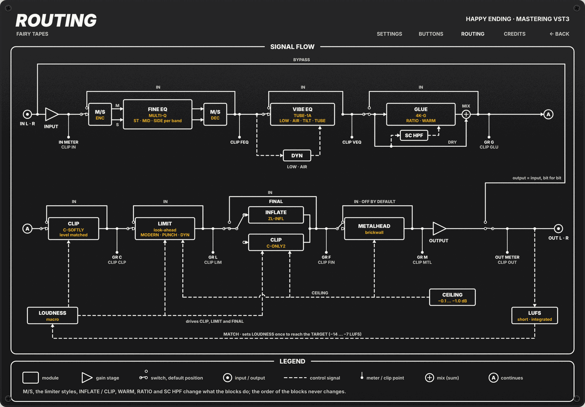

# Fairy Tapes · Happy Ending

Happy Ending is a mastering chain for the master bus, in VST3 format. It puts the usual finishing tools in one fixed order: a fine EQ, a Pultec-style EQ, a bus compressor, a clipper, a limiter and a final loudness stage, all under one output ceiling. Every control is stepped, the ranges are narrow and the starting values already suit a master, so a few moves are enough to turn a finished mix into a clean, loud master.

**Status:** the audio engine and the VST3 plug-in are done, with their tests (plan Tasks 1-13 and 15). The by-ear tuning of the starting values (Task 14) is still to do, and the delay compensation has been checked by the tests but not yet in a host. The graphic editor has its own plan and is not built yet: the host shows its generic parameter list, so the meters, the LUFS readout and the MATCH, LISTEN and SET buttons are not reachable for now.

## When to use it

- **Finishing a mix.** Put it last on the master bus for a final EQ touch, some glue and the final push to the ceiling.
- **Hitting a streaming loudness target.** Pick a TARGET (−14, −11, −9 or −7 LUFS), set CEIL to −1.0 dB as the streaming margin and raise LOUDNESS. With the editor, MATCH will set LOUDNESS for you.
- **A quick reference master.** Every stage except METALHEAD is on at load, with values meant for a master. Raise LOUDNESS, and flip BYPASS to hear the mix as it was.
- **Mid/side clean-up.** Every FINE EQ band can work on stereo, mid or side. On SIDE the high pass switches to a mono-bass scale (60 to 200 Hz).
- **Extreme loudness.** METALHEAD adds a brickwall after the final stage, for genres that want it.

Bus: stereo in, stereo out. A mono track (mono in, mono out) is processed as dual mono. There is no sidechain input.

## Signal flow



The diagram is the ROUTING page of the panel preview (the editor itself is not built yet). It leaves out the oversampling and the output safety stages, described below.

1. **INPUT** sets the level going into the chain.
2. **FINE EQ** makes precise corrections with six stepped bands, each on stereo, mid or side.
3. **VIBE EQ** paints broad strokes: low boost with the cut above it, air, tilt and a tube stage. DYN can pull the boosts back on loud passages.
4. **GLUE** is a bus compressor blended in parallel with the dry signal.
5. **CLIP** rounds the peaks and leaves the quiet parts at the same level.
6. **LIMIT** is a look-ahead limiter that brings the peaks to the ceiling.
7. **FINAL** either inflates the body of the sound (INFLATE) or drives it into the ceiling (CLIP).
8. **METALHEAD** is an optional brickwall for extreme loudness, off by default.
9. **OUTPUT** sets the final level. A safety limiter and a hard clamp behind it keep the output under CEIL.
10. **BYPASS** switches to the input, delayed by the latency. The meters and the LUFS reading always read the plug-in output.

LOUDNESS drives CLIP, LIMIT and FINAL on top of their own settings. CEIL is shared by LIMIT, FINAL, METALHEAD and the output safety stages. Every stage has its own IN switch. The order of the blocks never changes.

### Block by block

- **INPUT / OUTPUT:** ±12 dB in 0.5 dB steps. Changes glide over 64 samples.
- **FINE EQ:** six stepped bands (HI PASS, LOW SHELF, LO MID, MID, HI MID, HI SHELF), each with IN and M/S (Stereo, Mid, Side), plus a stage IN. HI PASS is 12 dB/octave. A bell narrows as its gain grows (Q coupling). LISTEN solos one of the three bells as a band-pass on its own route (stereo, mid or side); it is off while that bell or the stage is off. Analog-matched biquads (Vicanek designs for the bells and the high shelf) keep the analog curve up to Nyquist without oversampling: zero latency, minimum phase. Coefficient changes glide over 64 samples.
- **VIBE EQ:** Pultec-style passive network ported from the Tube EQ of Multi-Q. LOW is one knob for the boost (a bell at LOW FREQ) and the cut (a bell 2.5 times above it), the classic "Pultec trick". AIR is a broad bell that keeps its width near Nyquist. TILT is a pair of opposite shelves around 1 kHz. TUBE is the tube stage at the output of the network (TUBE 0 is an exact bypass); it runs in the oversampled zone. DYN LOW and DYN AIR pull the boost back on loud program, by up to 80 % of the amount (starting values: threshold −18 dB, attack 10 ms, release 200 ms; the LOW detector hears below 400 Hz, the AIR detector above 2 kHz).
- **GLUE:** SSL-style bus compressor (Multi-Comp `BusCompressor`, Console Bus colour: input and output transformers, 2nd and 3rd harmonics). Feedback detector as in the source: the previous compressed output, high-passed by SC HPF, 5 ms RMS. Over-easy knee of 10 dB, 20 dB of reduction at most, program-dependent Auto release (150 to 450 ms). Stereo is always fully linked. WARM triples the attack time constant. MAKEUP acts on the compressed branch only, and MIX blends dry and compressed inside the block (MIX 0 % is the input unchanged). MAKEUP, MIX and IN glide over 10 ms.
- **CLIP:** level-matched soft clipper (ClipSoftly): DRIVE goes in front of the shaper and its reciprocal behind it, so quiet parts pass unchanged and the peaks are rounded. Zero latency. Its IN crossfades with the dry signal over 10 ms.
- **LIMIT:** look-ahead sample-peak limiter, one gain for both channels. THRESH also sets the gain recovery, as in an L2: a sample at the threshold comes out at the ceiling, so a lower THRESH means a louder master. Styles: MODERN (look-ahead 1.5 ms, hard knee), PUNCH (look-ahead 0.3 ms with a slower attack ramp, so the first instant of a transient passes), DYN (look-ahead 0.8 ms, 6 dB soft knee, release that follows the program). RELEASE trims the release of the style. SET is a guided release setting: the threshold glides to −8 dB while the gain recovery stays that of THRESH, so you hear the release working without a jump in level. A final per-sample guard keeps every output sample at or under the ceiling in every style.
- **FINAL:** INFLATE or CLIP, both under the ceiling. INFLATE (ZLInflator, through `shared/inflator`) lifts the body of the program; its full scale is CEIL, so the peaks at the ceiling stay there. EFFECT is the wet amount and CURVE the shape. CLIP (ClipOnly2) is a soft clip with its knee on the ceiling; DRIVE is the gain in front and is not compensated (it is the loudness). Each mode keeps its own values; switching mode or IN crossfades over 10 ms.
- **METALHEAD:** optional brickwall after FINAL, off by default. It is the LIMIT engine in a fixed style (look-ahead 1 ms, release 30 ms, hard knee) with its threshold at CEIL minus PUSH: a program under the ceiling comes out PUSH dB louder, and the peaks stop at the ceiling.

## Controls

Names as they appear in the host's parameter list. All controls are stepped.

**Service row**

| Control | Range / values | Default | What it does |
|---|---|---|---|
| Bypass | Off / On | Off | Switches to the input delayed by the latency (see [Bypass](#bypass)). |
| Input Gain | −12 to +12 dB, 0.5 dB steps | 0 dB | Level into the chain. |
| Output Gain | −12 to +12 dB, 0.5 dB steps | 0 dB | Level after the chain, before the safety stages. |
| Ceiling | −0.1 / −0.3 / −0.5 / −1.0 dB | −0.3 dB | Highest output sample whenever LIMIT, FINAL or METALHEAD is on. |
| Loudness | 0 to 10, 0.5 steps | 0 | Pushes CLIP, then LIMIT, then FINAL on top of their settings. |
| Target | −14 / −11 / −9 / −7 LUFS | −14 LUFS | Loudness that MATCH aims for. |
| Oversampling | Off / 2x / 4x | 2x | Oversampling of the non-linear stages. Saved with the project, not automatable. |

**FINE EQ**

| Control | Range / values | Default | What it does |
|---|---|---|---|
| Fine EQ | Off / On | On | IN of the whole stage. |
| Hi Pass In, Low Shelf In, Lo Mid In, Mid In, Hi Mid In, Hi Shelf In | Off / On | On | IN of each band. |
| Hi Pass M/S, Low Shelf M/S, Lo Mid M/S, Mid M/S, Hi Mid M/S, Hi Shelf M/S | Stereo / Mid / Side | Stereo | Which part of the signal the band works on. |
| Hi Pass Freq | Off, 20, 25, 30, 35, 40 Hz; on Side: Off, 60, 80, 120, 160, 200 Hz | Off | 12 dB/octave high pass. |
| Low Shelf Freq | 30, 50, 70, 100, 150, 200, 300 Hz | 100 Hz | Low shelf frequency. |
| Lo Mid Freq | 100, 125, 160, 200, 250, 315, 400, 500, 630, 800 Hz | 250 Hz | Bell frequency. |
| Mid Freq | 400, 500, 630, 800 Hz, 1, 1.25, 1.6, 2, 2.5, 3.15 kHz | 1 kHz | Bell frequency. |
| Hi Mid Freq | 1.6, 2, 2.5, 3.15, 4, 5, 6.3, 8, 10, 12.5 kHz | 4 kHz | Bell frequency. |
| Hi Shelf Freq | 3, 5, 8, 10, 12, 16, 20 kHz | 12 kHz | High shelf frequency. |
| Low Shelf Gain, Lo Mid Gain, Mid Gain, Hi Mid Gain, Hi Shelf Gain | −4 to +4 dB, 0.5 dB steps | 0 dB | Band gain. |
| Lo Mid Q, Mid Q, Hi Mid Q | Wide / Medium / Narrow / Surgical (Q 0.5 / 1 / 2 / 5) | Medium | Bell width; the bell narrows further as its gain grows. |

**VIBE EQ**

| Control | Range / values | Default | What it does |
|---|---|---|---|
| Vibe EQ | Off / On | On | IN of the stage. |
| Low Freq | 20 / 30 / 60 / 100 Hz | 60 Hz | Frequency of the low boost (the cut sits 2.5 times above). |
| Low | 0 to 10 | 0 | Low boost and cut together (starting value: 1.4 dB of boost per step). |
| Air Freq | 5 / 8 / 10 / 12 / 16 kHz | 12 kHz | Frequency of the air boost. |
| Air | 0 to 10 | 0 | Broad high boost (starting value: 1.8 dB per step). |
| Tilt | −3 to +3 dB, 0.5 dB steps | 0 dB | Dark (negative) to bright (positive) around 1 kHz. |
| Tube | 0 to 10 | 2 | Tube stage drive; 0 is an exact bypass. |
| Dyn Low, Dyn Air | Off / On | Off | Pull the LOW / AIR boost back on loud program. |

**GLUE**

| Control | Range / values | Default | What it does |
|---|---|---|---|
| Glue | Off / On | On | IN of the stage. |
| Glue Thresh | −20 to 0 dB, 1 dB steps | −10 dB | Compressor threshold. |
| Glue Attack | 0.1 / 0.3 / 1 / 3 / 10 / 30 ms | 3 ms | Attack time. |
| Glue Release | 0.1 / 0.3 / 0.6 / 1.2 s / Auto | Auto | Release time; Auto follows the program (150 to 450 ms). |
| Glue Ratio | 1.5:1 / 2:1 / 4:1 | 2:1 | Ratio. |
| Glue Makeup | 0 to +6 dB, 0.5 dB steps | 0 dB | Gain of the compressed branch only. |
| Glue Mix | 0 to 100 %, 5 % steps | 50 % | Blend of dry and compressed (parallel compression). |
| Glue SC HPF | Off / 60 / 90 / 150 Hz | 60 Hz | High pass on the detector, so the bass drives the compressor less. |
| Glue Warm | Off / On | Off | Slower attack (time constant ×3). |

**CLIP**

| Control | Range / values | Default | What it does |
|---|---|---|---|
| Clip | Off / On | On | IN of the stage. |
| Clip Drive | 0 to +6 dB, 0.5 dB steps | +2 dB | How hard the peaks are rounded; level-matched. |

**LIMIT**

| Control | Range / values | Default | What it does |
|---|---|---|---|
| Limit | Off / On | On | IN of the stage. |
| Limit Thresh | 0 to −4 dB, 0.5 dB steps | −2 dB | Threshold and gain recovery: lower is louder. |
| Limit Style | Modern / Punch / Dyn | Modern | Look-ahead, knee and release behaviour (see above). |
| Limit Release | −4 to +4, centre "Style" | Style | Trims the release of the style in third-octave steps (factor 2^(k/3), about ×0.4 to ×2.5). Starting base releases: Modern 50 ms, Punch 100 ms, Dyn 250 ms. |

**FINAL**

| Control | Range / values | Default | What it does |
|---|---|---|---|
| Final | Off / On | On | IN of the stage. |
| Final Mode | Inflate / Clip | Inflate | Which of the two final stages is heard. |
| Final Effect | 0 to 100 %, 10 % steps | 50 % | INFLATE: wet amount. |
| Final Curve | 0 / 25 / 50 / 75 / 100 % | 25 % | INFLATE: shape of the curve. |
| Final Drive | 0 to +2 dB, 0.5 dB steps | +2 dB | CLIP: gain into the clip at the ceiling, not compensated. |

**METALHEAD**

| Control | Range / values | Default | What it does |
|---|---|---|---|
| Metalhead | Off / On | Off | IN of the stage. |
| Push | 0 to +6 dB, 0.5 dB steps | +2 dB | How much louder the program comes out; peaks stop at the ceiling. |

**Editor-only controls** (hidden from the host's parameter list, never saved, always off at load)

| Control | Range / values | Default | What it does |
|---|---|---|---|
| LISTEN | Off / Lo Mid / Mid / Hi Mid | Off | Solos one FINE EQ bell as a band-pass on its own route. |
| SET | Off / On | Off | Guided release setting of LIMIT (threshold to −8 dB, gain recovery unchanged). |
| MATCH | button | | Moves LOUDNESS once to reach TARGET (see below). |

## Loudness and ceiling

- **LOUDNESS** (0 to 10) adds push on top of the stage settings; the stage controls themselves never move, and at 0 the sound is exactly that of the stage settings. The travel is split in thirds: CLIP gets up to +1.5 dB of drive (0 to 3.3), then LIMIT gets its threshold up to 3 dB lower (3.3 to 6.7), then FINAL gets up to +60 % of EFFECT or +2 dB of DRIVE, within the range of the control (6.7 to 10). These are starting values, to be tuned by ear.
- **TARGET** and **MATCH:** MATCH reads the short-term loudness and moves LOUDNESS once, so that the program reaches the TARGET (one 0.5 step of LOUDNESS per 0.75 dB of error, starting value). Press it on the loudest part of the song. With no measurement yet it does nothing. MATCH is a button of the editor.
- **CEIL:** whenever LIMIT, FINAL or METALHEAD is on, no output sample exceeds CEIL (−0.1 / −0.3 / −0.5 / −1.0 dB), OUTPUT gain included. After OUTPUT, a transparent base-rate safety limiter (threshold = CEIL, no gain recovery so it never raises the level, 1 ms look-ahead, 50 ms release) catches what the oversampling filter and the OUTPUT gain push back above the ceiling. A hard ceiling guard behind it is the last net. With LIMIT, FINAL and METALHEAD all off, both are off and OUTPUT acts freely.
- **No true-peak detection** (a design choice): the limiters work on the sample peak. CEIL −1.0 dB is the margin for streaming.

## Oversampling

Off / 2× / 4×, default 2×. It is a setting saved in the project, not an automation target. Only the non-linear parts run oversampled, in two zones: the VIBE EQ TUBE stage, and CLIP → LIMIT → FINAL → METALHEAD. FINE EQ, the VIBE EQ network and GLUE run at the base rate. The filters are linear-phase half-band stages (100 dB stopband), flat to 20 kHz at 44.1 kHz. Changing the setting asks the host to re-read the latency; the zones are rebuilt when the host re-activates the plug-in.

## Latency

Each oversampler adds 69 samples at 2× and 76 at 4× (at the base rate), and the chain has two of them. The look-aheads add to that: LIMIT and METALHEAD (1.5 ms each, the look-ahead of MODERN, whatever the style), FINAL (one sample) and the 1 ms safety limiter, which counts whether it is active or not. At 48 kHz this comes to about 4 ms with oversampling off and about 7 ms at 2× or 4×. The total is reported to the host and changes only with the oversampling setting or the sample rate, never with styles, modes or IN switches.

## Bypass

BYPASS crossfades over 64 samples to the input delayed by the reported latency, so it is sample-exact once settled and stays aligned with the other tracks. The chain keeps running behind it, so the meters and the LUFS reading stay live. LISTEN and SET are never saved in the state and always start off.

## Install and build

There is no release yet. Until there is one, build from source or take the CI artifact for your system (`happy-ending-linux`, `happy-ending-windows`, `happy-ending-macos`). Copy `HappyEnding.vst3` into your host's VST3 folder; the folders and the clone instructions are in the [main README](../../README.md).

To build, use a build folder outside the repository and build only the targets you need (building every target of the suite at once needs a lot of memory):

```
cmake -S . -B /tmp/he-build -DCMAKE_BUILD_TYPE=Release -DGPU_NAM_DISABLE_CUDA=ON
cmake --build /tmp/he-build --target happy_ending -j2
```

The bundle `HappyEnding.vst3` is written to `dist/` at the root of the repository. CI (on push and pull requests to `master`) builds all targets and uploads it as `happy-ending-linux`, `happy-ending-windows` and `happy-ending-macos`; it does not run `ctest`.

## Tests

```
cmake --build /tmp/he-build --target happy_ending_params_tests happy_ending_fine_eq_tests \
  happy_ending_vibe_eq_tests happy_ending_glue_tests happy_ending_oversampler_tests \
  happy_ending_clip_tests happy_ending_limiter_tests happy_ending_final_tests \
  happy_ending_loudness_tests happy_ending_loudness_macro_tests happy_ending_engine_tests \
  happy_ending_state_tests happy_ending_display_tests happy_ending_controller_tests \
  happy_ending_factory_test happy_ending_processor_level_test -j2
ctest --test-dir /tmp/he-build -R happy_ending --output-on-failure
```

One executable per block, with the `RUN_TEST` / `ASSERT_TRUE` harness and synthetic signals. The two module tests (`factory`, `processor_level`) load `dist/HappyEnding.vst3`: build `happy_ending` first, or they are skipped (exit 77). They are not built on Windows. The others link the code directly. The tests cover the parameter table, every DSP block (curves against analog prototypes, M/S, LISTEN, DYN, GLUE reduction and MIX, level-matched CLIP, ceiling guarantees for every LIMIT style, SET, FINAL and METALHEAD, oversampler latency and flatness, BS.1770 reference loudness, LOUDNESS and MATCH), the engine (BYPASS, latency per oversampling, the safety limiter, all-max never above the ceiling, silence after the tail, no allocation in `process`), the saved state and the processor. All tuning values are read from `src/tuning.h`, never copied.

## Tuning

Every value to be voiced by ear lives in `src/tuning.h` and only there: VIBE DYN threshold and times, LIMIT release bases, SET threshold, LOUDNESS curve, MATCH step. They are still the starting values of the preview; the by-ear pass in a host (REAPER or Bitwig) is still to do.

## Third-party code and licences

The plug-in is **GPL-3.0**. Every ported file starts with a header naming its origin, author, licence and path. The full list for the suite is in [THIRD_PARTY.md](../../THIRD_PARTY.md).

| Component | Author | Licence | Used for | Source |
|---|---|---|---|---|
| Multi-Q, `AnalogMatchedBiquad` | Dusk Audio | GPL-3.0 | matched biquads (`src/dsp/matched_biquad.h`) for FINE EQ and VIBE EQ | `vendors/dusk-audio-plugins/plugins/multi-q/AnalogMatchedBiquad.h` |
| Multi-Q, Tube EQ (`InductorModel`, `TubeEqLFSection`, `TubeEQTubeStage`, `ADAASaturation`) | Dusk Audio | GPL-3.0 | VIBE EQ (`src/dsp/vibe_eq.*`) | `vendors/dusk-audio-plugins/plugins/multi-q/TubeEQProcessor.h`, `.../ADAASaturation.h` |
| Multi-Comp, `BusCompressor` | Dusk Audio | GPL-3.0 | GLUE (`src/dsp/glue.*`) | `vendors/dusk-audio-plugins/plugins/multi-comp/multicomp.cpp`, with the Console Bus profile of `HardwareEmulation/HardwareMeasurements.h` and `HardwareEmulation/TransformerEmulation.h` |
| ClipSoftly | Chris Johnson (Airwindows) | MIT | CLIP (`src/dsp/clip_softly.h`) | `vendors/airwindows/plugins/LinuxVST/src/ClipSoftly/ClipSoftlyProc.cpp` |
| ClipOnly2 | Chris Johnson (Airwindows) | MIT | FINAL clip mode (`src/dsp/clip_only2.h`) | `vendors/airwindows/plugins/LinuxVST/src/ClipOnly2/ClipOnly2Proc.cpp` |
| ZLInflator | zsliu98 (ZL Audio) | GPL-3.0 | FINAL inflate, through `shared/inflator/inflator.h` | [github.com/ZL-Audio/ZLInflator](https://github.com/ZL-Audio/ZLInflator) (`Source/DSP/ShaperFunctions.h`, `WaveShaper.h`), not a submodule |
| libebur128 | Jan Kokemüller | MIT | prototype constants of the K-weighting filters (`src/dsp/loudness_meter.cpp`) | not vendored: constants only, no code copied |
| "Matched Second Order Digital Filters" | Martin Vicanek (2016) | published method | matched peaking and high shelf (`src/dsp/matched_biquad.h`) | not vendored: credit for the method, own implementation |

The LIMIT (with METALHEAD and the safety limiter), the oversampler and the BS.1770 meter are our own code.

Submodule commits at the time of writing: `vendors/dusk-audio-plugins` 9b2ced59c425c7e74920c740918cbc049f4e7d0c, `vendors/airwindows` e68f75154ed0520fc5757fec9e7792dd1747e5ee, `vendors/vst3sdk` 3cdf9ca5d1f5b1b21e0a86832aa4abe55607bd96 (VST 3 SDK and VSTGUI, Steinberg: MIT and BSD-3-Clause). `vendors/airwindows` and `vendors/dusk-audio-plugins` are reference sources: the build does not fetch them (see [THIRD_PARTY.md](../../THIRD_PARTY.md)).

The `LICENSE` file of each origin project was checked at the pinned commit on 2026-11-02.

## Documents

- Design spec: [docs/superpowers/specs/2026-10-21-happy-ending-design.md](../../docs/superpowers/specs/2026-10-21-happy-ending-design.md)
- Implementation plan (audio engine and VST3 plug-in): [docs/superpowers/plans/2026-10-24-happy-ending.md](../../docs/superpowers/plans/2026-10-24-happy-ending.md)
- HTML preview of the panel: [docs/mockups/happy_ending_rack.html](docs/mockups/happy_ending_rack.html) (open it in a browser)
- Shared visual rules of the suite: [docs/DESIGN_SYSTEM.md](../../docs/DESIGN_SYSTEM.md)
- Third-party components of the suite: [THIRD_PARTY.md](../../THIRD_PARTY.md)
