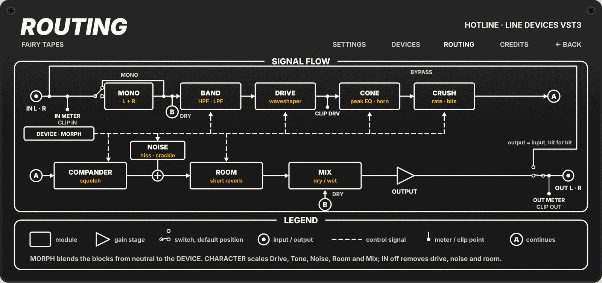

# Fairy Tapes · Hotline

Hotline makes a sound come out of a device: a megaphone, a telephone, a walkie-talkie, an AM radio, a station PA or a
cheap speaker. It is made for vocals, and works on instruments or the whole mix for an effected intro. One **Morph** knob
goes from the clean signal to the full device, so a "radio intro that opens up" is a single automation curve. Zero
latency.

**Status:** DSP, editor and automated tests are done. Still to check: the editor in a real host, the six devices by ear,
and the Windows and macOS builds (they run in the CI on the next merge to `master`).

## When to use it

- **Phone or radio voice.** A line of dialogue, an ad-lib or a backing vocal that sounds like it comes through a
  telephone or a walkie-talkie.
- **Intro that opens up.** Automate Morph from 100 % to 0 % and the track goes from AM radio (or megaphone) to the full,
  clean sound without a click.
- **Megaphone or PA shout.** A hook or a chant that sounds like it comes from a horn or a station announcement, with a
  short room around it.
- **Lo-fi layer.** A cheap speaker or a telephone on a parallel copy of a guitar or a drum loop, with Mix to blend it.
- **Narrow, mono effect.** Turn **Mono** on to sum the track before the device, as real phones and radios do.

## Signal flow



1. **Input.** Stereo input. The IN meter and the IN clip LED read it here. Non-finite samples (NaN, infinity) become
   silence.
2. **Mono.** When **Mono** is on, left and right are summed before the device, and both outputs carry the same signal.
3. **Dry tap.** The dry signal for **Mix** is taken here, after Mono and before the device.
4. **Band.** High-pass and low-pass filters (4th order each) set the bandwidth of the device. **Tone** moves them.
5. **Drive.** An asymmetric tanh waveshaper, followed by a DC blocker. The DRV clip LED watches its output.
6. **Cone.** A resonant peak of the speaker cone, plus a second "horn" peak above it (megaphone only).
7. **Crush.** Lower sample rate and bit depth, like a digital phone or radio codec.
8. **Compander.** A compressor, followed on the walkie-talkie by a squelch gate that closes when the signal is weak.
9. **Noise.** Line hiss and sparse crackle are added here.
10. **Room.** A short reverb (about 0.5 s), with a decorrelated tail on the right channel.
11. **Mix.** Dry/wet balance between the dry tap (step 3) and the device.
12. **Output gain.** **Gain** (−20 to +20 dB), then a safety ceiling at +24 dBFS.
13. **Bypass.** Fades in 5 ms to the input, then copies it bit for bit. The OUT meter and the OUT clip LED read the final
    output.

**Device** loads one row of the device table into blocks 4 to 10. **Morph** blends every block from neutral (0 %, the
signal passes untouched) to that row (100 %). The order of the blocks never changes.

## Devices

Each device is one row of a table (`src/devices.cpp`). The DEVICES tab on the back of the panel prints the same values.

| Device | Band | Drive | Cone | Codec | Compander | Noise | Room |
|---|---|---|---|---|---|---|---|
| Megaphone | 400 Hz to 4.5 kHz | 50 % | 1.8 kHz +6 dB, horn +4 dB | none | 3:1 | −60 dB | 5 % |
| Telephone | 300 Hz to 3.4 kHz | 25 % | 1.2 kHz +3 dB | 8 kHz, 10 bit | 2:1 | −54 dB | none |
| Walkie-talkie | 400 Hz to 2.8 kHz | 70 % | 1.5 kHz +4 dB | 11.025 kHz, 8 bit | 6:1, squelch −50 dB | −40 dB | none |
| AM radio | 150 Hz to 5 kHz | 30 % | 900 Hz +2 dB | none | 2:1 | −48 dB | none |
| Station PA | 250 Hz to 6 kHz | 20 % | 2.5 kHz +4 dB | none | 2:1 | −66 dB | 60 % |
| Cheap speaker | 180 Hz to 7 kHz | 40 % | 1.1 kHz +5 dB | none | none | −70 dB | none |

These are starting values, still to be refined by ear.

## Controls

All 11 controls are host parameters: you can automate them and see them in the host's generic parameter list. Default
values are in brackets.

| Control | Range / values | What it does |
|---|---|---|
| Device | Megaphone, Telephone, Walkie-talkie, AM radio, Station PA, Cheap speaker (Megaphone) | Picks the device. On the panel: six buttons (MEGA, PHONE, WALKIE, AM RADIO, PA, CHEAP). A change glides over a few tens of milliseconds, without clicks. |
| Morph | 0 to 100 % (100 %) | 0 % = clean signal, exactly the input. 100 % = the full device. Safe to automate. |
| Drive | 0 to 100 % (50 %) | Scales the device's own drive: 50 % = as the device, 0 % = off, 100 % = twice. The panel scale reads 0 to 10. |
| Tone | −5.0 to +5.0 (0.0) | Dark to bright: at +5.0 the low-pass moves up one octave and the high-pass down half an octave; at −5.0 the opposite. The shift scales with Morph. |
| Noise | 0 to 100 % (50 %) | Scales the device's noise level: 50 % = as the device, 0 % = no noise. Never louder than −20 dB. The panel scale reads 0 to 10. |
| Room | 0 to 100 % (50 %) | Scales the device's room: 50 % = as the device, 0 % = dry. Devices without a room stay dry. The panel scale reads 0 to 10. |
| Mix | 0 to 100 % (100 %) | Dry/wet balance of the whole device. |
| Character In | Off / On (On) | The IN button of the CHARACTER box. Off: Drive, Tone, Noise, Room and Mix are ignored; the device keeps its band, cone, codec and compander, with no drive, no noise, no room and Mix at 100 %. |
| Gain | −20 to +20 dB (0 dB) | Output level, after Mix. |
| Mono | Off / On (Off) | Sums left and right before the device; both outputs are the same. |
| Bypass | Off / On (Off) | Global bypass (the host's bypass parameter). After a 5 ms fade the output is a bit-exact copy of the input. |

## Editor

The editor is a rack panel of 1000 x 470 logical pixels, drawn entirely by code. On Windows and Linux it follows the
scale factor the host gives (2000 x 940 at 200 %); on macOS the system handles Retina. You cannot resize it.

The front panel has five boxes:

- **DEVICE:** six buttons with the device name on the face; the selected one lights amber.
- **LEVEL:** LED meters for IN L/R and OUT L/R, scale −60 to +6 dB, with a peak-hold marker. Three clip LEDs: **IN** and
  **OUT** light when a sample reaches 0 dBFS; **DRV** lights only when the drive stage is fully engaged (effective drive
  10 % or more) and its output reaches 0.9. They stay on for 2 seconds; click one to clear all three.
- **OUTPUT:** the **Gain** knob, the **Bypass** button (red LED) and the **Mono** button (yellow LED).
- **MORPH:** one large knob, from CLEAN to FULL.
- **CHARACTER:** Drive, Tone, Noise, Room and Mix, and the **IN** button (red LED) of the box.

Knobs are black aluminium. Drag a knob up or down to turn it, hold **Shift** for fine steps, **double-click** to go back
to the default. Every gesture reaches the host as an edit, so automation and undo work. With IN off the five CHARACTER
controls are dimmed. **Bypass** dims everything except itself; the IN/OUT meters and their clip LEDs stay lit, the DRV
LED dims. Dimmed controls still respond (on purpose).

**Wear, tape and screws:**

- **Wear** (Off / Light / Heavy): scratches, stains and dirt are generated from a seed stored with each instance.
  Changing Wear changes how much you see, not the pattern.
- **Paper tape:** none with Wear Off, 1 or 2 with Light, 2 or 3 with Heavy, in six places that do not cover the
  controls. Click a tape to write on it (up to 14 printable ASCII characters; Enter or a click elsewhere confirms, Esc
  cancels). The text is drawn in one of three handwriting fonts, embedded as vector outlines, so there is nothing to
  install. A tape you never wrote on stays blank. The texts are saved with the project.
- **Screws** in the four corners (slot or cross head; now and then one is missing). Drag a screw to turn it. The angle
  is saved with the project. The screws are there with Wear Off too, and on the back panel with the same rotation.

**Back panel.** Click **BACK →** at the top right to turn the panel; **← BACK** turns it to the front.

- **SETTINGS:** Appearance, saved in your preferences for every project: WEAR Off / Light / Heavy and TAPE FONT
  Zeyada / Rock Salt / Homemade Apple. The Behaviour box is empty: Hotline has no per-project setting yet.
- **DEVICES:** the block values of the six devices (the table above).
- **ROUTING:** the signal flow diagram.
- **CREDITS:** version, licence, third-party components with author and licence, legal notices.

### Where preferences live

The Appearance settings are kept in `FairyTapes/Hotline.prefs` (lines `key=value`), a file of its own, separate from the
other plug-ins. Hotline uses the keys `wear` and `tapeFont`; `notes` and `valuesFont` are kept in the file but Hotline
has nothing that uses them.

| System | Path |
|---|---|
| Linux | `$XDG_CONFIG_HOME/FairyTapes/Hotline.prefs` (when that variable is an absolute path), otherwise `~/.config/FairyTapes/Hotline.prefs` |
| macOS | `~/Library/Application Support/FairyTapes/Hotline.prefs` |
| Windows | `%APPDATA%\FairyTapes\Hotline.prefs` |

A missing, unreadable, binary or oversized (over 64 KB) file, or an invalid value, falls back to the defaults, one
setting at a time. Writes are atomic; a failed write is never fatal. You can delete the file safely.

## Install and build

Pre-built bundles are not published yet. To install a bundle you built, copy `Hotline.vst3` into your host's VST3 folder
(the root [README](../../README.md#download) lists the folders).

Clone the repository with its submodules (see the root [README](../../README.md#getting-the-sources)): the suite is
configured as a whole. Build in a scratch folder outside the repository, and only the targets you need:

```bash
cmake -S . -B /tmp/hotline-build -DCMAKE_BUILD_TYPE=Release -DGPU_NAM_DISABLE_CUDA=ON
cmake --build /tmp/hotline-build -j2 --target hotline hotline_tests hotline_ui_tests hotline_decor_tests \
  hotline_back_tests hotline_factory_test hotline_state_module_test hotline_processor_test
ctest --test-dir /tmp/hotline-build -R hotline --output-on-failure
```

Output: `dist/Hotline.vst3` in the repository root, whatever the build folder. The factory, state module and processor
tests load that bundle (on Linux and macOS) and are skipped if it is missing.

**Linux system packages.** VSTGUI needs these to build (the list used by the CI, Ubuntu 24.04):

```bash
sudo apt-get install -y \
  libcairo2-dev libfreetype-dev libfontconfig1-dev libpango1.0-dev \
  libxcb1-dev libxcb-util-dev libxcb-cursor-dev libxcb-keysyms1-dev libxcb-xkb-dev \
  libxkbcommon-dev libxkbcommon-x11-dev \
  libx11-dev libx11-xcb-dev libwayland-dev wayland-protocols \
  libglib2.0-dev libgtkmm-3.0-dev libsqlite3-dev libexpat1-dev
```

To run the editor you need the matching runtime libraries (Cairo, Pango, FreeType, Fontconfig, xcb, xkbcommon). The
editor embeds only in X11 windows: native Wayland windows are refused, so the host must run on X11 or XWayland.

## Technical notes

### Buses, latency and tail

One stereo input and one stereo output (other arrangements are refused). No latency: nothing looks ahead. The reported
tail is the time the longer of the two room tails takes to fall below −60 dB. Block values (device row, Morph and the
user controls) are recomputed every 32 samples and follow their target with a 10 ms smoothing; frequencies move on a
log scale, levels in dB. At Morph 0 every block lands exactly on its pass-through path.

### Saved state (v2)

The project stores `kStateVersion = 2`: the 11 normalized parameter values, then the instance **decor** (the wear seed,
the angles of the four screws as the user's rotation added to the seeded angle, the tape texts). The layout is the same
as Pillow Talk's v2. A v1 state (parameters only) still loads with a default decor; a missing or 0 seed generates a new
one, saved with the next `getState`. An unknown version, short data or a non-finite parameter refuses the state.
Parameters are clamped to [0, 1], angles wrap to [0, 360), tape texts keep printable ASCII only (at most 14 characters,
6 texts). Editing the decor marks the project as changed.

### Hidden display parameters

The LEVEL box reads read-only hidden parameters (`kIsReadOnly | kIsHidden`), from ID 1000, outside the persistent table
and not saved. If the host does not forward them to the controller, the meters stay still but the plug-in works
normally.

| ID | Symbol | Normalized value |
|---|---|---|
| 1000 / 1001 | `kMeterInL` / `kMeterInR` | input peak L / R, linear over −60 to +6 dB |
| 1002 / 1003 | `kMeterOutL` / `kMeterOutR` | output peak L / R (after Bypass), linear over −60 to +6 dB |
| 1004 | `kClipIn` | 1 when an input sample reached 1.0 or more, held for 2 s of audio time |
| 1005 | `kClipDrive` | 1 when the drive output reached 0.9 with effective drive 10 % or more, held for 2 s |
| 1006 | `kClipOut` | 1 when an output sample reached 1.0 or more, held for 2 s |
| 1007 | `kClipClear` | the only writable one: the editor writes 1 when a clip LED is clicked; the processor clears the clips and answers 0 |

### Graphics

There is no background image: panel, boxes, printing, controls, wear, tapes and screws are drawn by code with the shared
kit in `shared/ui`. The only asset is the grain tile `shared/ui/assets/panel_grain.png`, copied into the bundle
(`Contents/Resources`) after the build; without it the panel is plain `#161617`.

The tape font outlines live in `shared/ui/include/fairy_ui/tape_glyphs.h`, shared by the suite. They are generated
(needs `fontTools`) by `shared/ui/tools/gen_tape_fonts.py` from the TTF files listed in
`shared/ui/assets/fonts/README.md` (sources, SHA-256 and licences). From the repository root:

```bash
python3 shared/ui/tools/gen_tape_fonts.py --zeyada Zeyada.ttf --rocksalt RockSalt-Regular.ttf \
  --homemade HomemadeApple-Regular.ttf --out shared/ui/include/fairy_ui/tape_glyphs.h
```

### Render tool

`hotline_render` draws the editor offscreen into a PNG, without a host. It is not built by default:
`cmake --build <build> --target hotline_render`. Options: `bypass`, `characterin=off`, `device=<0..5>`, `mono`,
`meters`, `clips`, `no-grain`, `wear=off|light|heavy`, `seed=<n>`, `tape<slot>=<text>`, `screw<i>=<degrees>`,
`tapefont=<0..2>`, `back=settings|devices|routing|credits`, `flip=<0..1>`, `set=<key>:<index>`. `set=` writes the
user's preferences file, as a click on the back would: point `XDG_CONFIG_HOME` at a scratch folder when you use it. The
full list is at the top of `tools/render_editor.cpp`.

The back of the HTML preview (`docs/mockups/hotline_rack.html`) is out of date (628 px tall, no DEVICES tab, credits
taken from The Stripper); the reference for the back panel is a render of `hotline_render`.

### Manual check list

- [ ] Look compared with the preview (front panel) and with `hotline_render` (back panel).
- [ ] Open and close the editor many times (no crash, no hang).
- [ ] Move every control: automation records it and undo reverts it.
- [ ] Listen to the six devices on a vocal; Morph automated from 0 to 100 % without clicks.
- [ ] Meters and the IN, DRV and OUT clip LEDs with a real signal; a click on a clip LED clears them.
- [ ] Wear Off / Light / Heavy; write on a tape; turn the screws; flip to the back; settings that persist.
- [ ] HiDPI (Windows or Linux at 150 to 200 %): size = 1000 x 470 times the factor, sharp.
- [ ] Linux: X11 embedding only; with native Wayland the editor is refused.

## Third-party code and licences

Hotline is free software under the GNU General Public License v3.0 ([LICENSE](../../LICENSE)). It has none of The
Stripper's third-party DSP components (no NAM, Dusk Audio, Airwindows, Eigen or nlohmann/json).

| Component | Author | Licence | Used for |
|---|---|---|---|
| VST 3 SDK | Steinberg Media Technologies | MIT | plug-in format, processor and controller |
| VSTGUI | Steinberg Media Technologies | BSD-3-Clause | the editor |
| `fairy_ui` (`shared/ui`) | Fairy Tapes | GPL-3.0 | shared rack controls, meters, wear, tapes, screws, back panel, routing diagram |
| Zeyada (tape font) | Kimberly Geswein | SIL Open Font License 1.1 | handwriting on the tapes, embedded as vector outlines |
| Rock Salt (tape font) | Font Diner (Sideshow) | Apache-2.0 | handwriting on the tapes, embedded as vector outlines |
| Homemade Apple (tape font) | Font Diner | Apache-2.0 | handwriting on the tapes, embedded as vector outlines |
| Freeverb tuning values | Jezar at Dreampoint | Public domain | Room: the comb and allpass delay lengths and the stereo spread (own Schroeder implementation, no Freeverb code) |

The filter coefficients follow the published RBJ Audio EQ Cookbook formulas (own implementation). Font sources and
licence texts: [shared/ui/assets/fonts/README.md](../../shared/ui/assets/fonts/README.md). The whole suite:
[THIRD_PARTY.md](../../THIRD_PARTY.md).

## Documents

- Design spec: [2026-10-10-hotline-design.md](../../docs/superpowers/specs/2026-10-10-hotline-design.md) (the editor is
  covered there too, §4 and §5)
- Plan: [2026-10-10-hotline.md](../../docs/superpowers/plans/2026-10-10-hotline.md)
- HTML preview: [docs/mockups/hotline_rack.html](docs/mockups/hotline_rack.html)
- Common design rules: [docs/DESIGN_SYSTEM.md](../../docs/DESIGN_SYSTEM.md)
