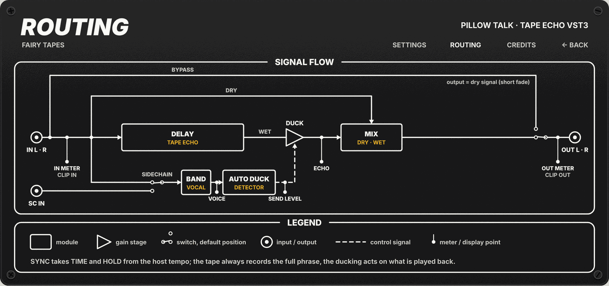

# Fairy Tapes · Pillow Talk

Pillow Talk is a tape echo that turns its own repeats down while the singer sings and lets them come back in the pauses.
The echoes land after each line instead of on top of the words, and you do not need to automate the send. Put it on the
vocal track, or on a return bus fed by several tracks with the vocal on the sidechain input.

**Status:** DSP, editor and automated tests are done. Still to check by hand in Reaper and Cubase (see the manual check
list below), and the default Hold, Release and Feedback values are still to be tuned by ear.

## When to use it

- **Lead vocal echo without send automation.** Insert it on the vocal: the repeats stay low while the words are sung and
  open up at the end of each phrase.
- **Shared echo on a return bus.** Several tracks feed the bus, and the lead vocal, sent to the sidechain input, decides
  when the echo ducks.
- **Throws on rap and spoken word.** A tempo-synced echo (1/8 or 1/4) that only speaks in the gaps between lines.
- **Dark, dirty repeats.** Feedback, Tone and Saturation act inside the tape loop, so every repeat is a bit darker and
  more compressed than the one before.
- **Plain tape echo.** With Depth at 0 dB nothing is ducked and Pillow Talk is a normal tape delay with wow and flutter.

## Signal flow



1. **Input.** Main stereo input (a mono bus works too). The IN meter and the IN clip LED read it here, before anything
   else.
2. **Auto duck detector.** It listens to the main input, or to the sidechain input when **Sidechain** is on and the host
   has the sidechain bus active. It sums to mono and keeps only the voice range (band-pass 120 Hz to 5 kHz), so kick,
   rumble and hiss do not trigger it. When this level goes above **Threshold**, the echo level drops by **Depth**. When
   the voice falls below the threshold, the echo stays down for **Hold**, then comes back up over **Release**.
3. **Tape echo.** The tape always records the full input: the ducking never touches what goes onto the tape. Inside the
   feedback loop each pass goes through a low-pass filter (**Tone**), a biased tanh saturation (2x oversampled) and a
   100 Hz high-pass. The tape is read back with wow and flutter. Changes of the delay time glide like a tape speed
   change, without clicks. The longest delay is about 2 seconds.
4. **Duck.** The detector's gain scales the echo coming off the tape. The repeats keep decaying on the tape while the
   echo is ducked, and you hear what is left of them when it opens again.
5. **Mix.** `out = dry × (1 − Mix) + ducked echo × Mix`. Mix moves smoothly (about 20 ms).
6. **Bypass and output.** Bypass fades Mix to 0 in about 20 ms, so the output is the dry signal. The OUT meter and the
   OUT clip LED read the final output.

## Controls

All 16 controls are host parameters: you can automate them and see them in the host's generic parameter list. Default
values are in brackets.

| Control | Range / values | What it does |
|---|---|---|
| Time | 20 to 1200 ms, logarithmic (155 ms) | Delay time when Time Sync is off. Moving it glides the pitch like a tape speed change. |
| Time Sync | Off / On (Off) | On: the delay time follows the host tempo and the note value chosen with Time Note. |
| Time Note | 1/16, 1/8, 1/4, 1/2 (1/4) | Delay time as a note value, used when Time Sync is on. |
| Feedback | 0 to 95 % (38 %) | Amount of repeats. Capped at 95 % so the echo never runs away. |
| Tone | 800 to 12000 Hz, logarithmic (4062 Hz) | Low-pass inside the loop: lower values make each repeat darker. |
| Saturation | 0 to 100 % (30 %) | Tape saturation inside the loop. The panel scale reads 0 to 10. |
| Wow/Flutter | 0 to 100 % (20 %) | Pitch wobble of the tape: slow wow, fast flutter and a little random drift. The panel scale reads 0 to 10. |
| Mix | 0 to 100 % (30 %) | Balance between dry signal and echo. Use 100 % on a return bus. |
| Threshold | −60 to 0 dB (−34.8 dB) | Level of the voice above which the echo ducks. |
| Ducking Depth | 0 to 60 dB, 60 = Mute (36 dB) | How much the echo is turned down while the voice is above the threshold. 0 dB means no ducking. |
| Hold | 50 to 1000 ms, logarithmic (224 ms) | How long the echo stays down after the voice drops below the threshold. Used when Hold Sync is off. |
| Hold Sync | Off / On (Off) | On: Hold follows the host tempo and the note value chosen with Hold Note. |
| Hold Note | 1/16, 1/8, 1/4, 1/2 (1/8) | Hold as a note value, used when Hold Sync is on. |
| Release | 50 to 2000 ms, logarithmic (316 ms) | How fast the echo comes back up after Hold. |
| Sidechain | Off / On (Off) | On: the detector listens to the sidechain input, when the host has it connected and active. Otherwise it listens to the main input. |
| Bypass | Off / On (Off) | Global bypass (the host's bypass parameter). The output fades to the dry signal in about 20 ms. |

Note values follow the host tempo. When the host sends no tempo, Pillow Talk uses 120 BPM (TEMPO FALLBACK on the back
panel). If the sidechain is connected but silent, the echo stays open.

### Sidechain in your host

- **Reaper:** the sidechain is on channels 3/4 of the plug-in. Set the track (or the return bus) to 4 channels, send the
  vocal to channels 3/4 of the track that holds Pillow Talk, then turn **Sidechain** on.
- **Cubase:** enable the side-chain input in the plug-in window header, route the vocal to it, then turn **Sidechain**
  on.
- As an insert on the vocal itself you need no sidechain: leave **Sidechain** off.

## Editor

The editor is a rack panel of 1000 x 470 logical pixels, drawn entirely by code. On Windows and Linux it follows the
scale factor the host gives (2000 x 940 at 200 %); on macOS the system handles Retina. You cannot resize it.

The front panel has five boxes:

- **DUCKING:** a scrolling display (6 seconds by default) and the **Sidechain** button. The grey area is the voice, as
  the detector sees it after its filter (a steady sine reads about 4 dB below its peak). The amber area is the echo as
  it reaches the output, after ducking and Mix. The green line is the send level (the gain applied to the echo). The
  dashed line is the threshold.
- **LEVEL:** LED meters for IN L/R (before anything) and OUT L/R (after Mix and Bypass), scale −60 to 0 dB. The **DUCK**
  row in amber shows how much the echo is turned down. Two clip LEDs (IN, OUT) light at 0 dBFS or above and stay on for
  2 seconds; click either clip LED to clear both. The meters hold their highest peak for the time set in DISPLAY PEAKS.
- **OUTPUT:** the **Mix** knob and the **Bypass** button.
- **DELAY:** Time, Feedback, Tone, Saturation, Wow/Flutter and a **SYNC** button.
- **AUTO DUCK:** Threshold, Depth, Hold, Release and a **SYNC** button.

Knobs are black aluminium. On/off buttons (Sync, Sidechain, Bypass) have a red LED. With SYNC on, the Time (or Hold)
knob gives its place to four note buttons (1/16, 1/8, 1/4, 1/2); the selected one lights amber. Drag a knob up or down
to turn it, hold **Shift** for fine steps, **double-click** to go back to the default. Every gesture reaches the host as
an edit, so automation and undo work. **Bypass** dims everything except itself: the display and the DUCK row dim, the
IN/OUT meters and the clip LEDs stay lit. Dimmed controls still respond (on purpose).

**Wear, tape and screws:**

- **Wear** (Off / Light / Heavy): scratches, stains and dirt are generated from a seed stored with each instance. The
  same seed gives the same marks as in The Stripper. Changing Wear changes how much you see, not the pattern.
- **Paper tape:** none with Wear Off, 1 or 2 with Light, 2 or 3 with Heavy, in six places that never cover a control,
  the display or a meter. Click a tape to write on it (up to 14 printable ASCII characters; Enter or a click elsewhere
  confirms, Esc cancels). The text is drawn in one of three handwriting fonts, embedded as vector outlines, so there is
  nothing to install. A tape you never wrote on stays blank. The texts are saved with the project.
- **Screws** in the four corners (slot or cross head; now and then one is missing). Drag a screw to turn it (right or
  up turns it clockwise). The angle is saved when you let go. The screws are there with Wear Off too.

**Back panel.** Click **BACK →** at the top right to turn the panel (about 0.8 s); **← BACK** turns it to the front.

- **SETTINGS, Appearance** (saved in your preferences, for every project): WEAR Off / Light / Heavy; NOTES LAYER Hide /
  Show (stored only, nothing is drawn yet); TAPE FONT Zeyada / Rock Salt / Homemade Apple; VALUES FONT Standard / Tape
  font (the yellow values under the knobs); LOOK **Re-roll** (a new seed: new wear, tapes and screws; screw rotations
  back to 0 and blank tapes).
- **SETTINGS, Behaviour** (saved in the project): DISPLAY WINDOW 3 / 6 / 12 s; DISPLAY PEAKS Off / 1.5 / 3 s (default
  1.5 s); TEMPO FALLBACK 120 BPM (the only value: the tempo used for note values when the host sends none).
- **ROUTING:** the signal flow diagram shown above.
- **CREDITS:** version, licence, third-party components with author and licence, legal notices.

### Where preferences live

The Appearance settings are kept in `FairyTapes/PillowTalk.prefs` (lines `key=value`, keys `wear`, `notes`, `tapeFont`,
`valuesFont`), a file of its own, separate from the other plug-ins:

| System | Path |
|---|---|
| Linux | `$XDG_CONFIG_HOME/FairyTapes/PillowTalk.prefs` (when that variable is an absolute path), otherwise `~/.config/FairyTapes/PillowTalk.prefs` |
| macOS | `~/Library/Application Support/FairyTapes/PillowTalk.prefs` |
| Windows | `%APPDATA%\FairyTapes\PillowTalk.prefs` |

A missing, empty, binary or oversized (over 64 KB) file, or an invalid value, falls back to the defaults, one setting at
a time. Writes are atomic; a failed write is ignored. You can delete the file safely.

## Install and build

Pre-built bundles are not published yet. To install a bundle you built, copy `PillowTalk.vst3` into your host's VST3
folder (the root [README](../../README.md#download) lists the folders).

Clone the repository with its submodules (see the root [README](../../README.md#getting-the-sources)): the suite is
configured as a whole. Build in a scratch folder outside the repository, and only the targets you need:

```bash
cmake -S . -B /tmp/pillow-talk-build -DCMAKE_BUILD_TYPE=Release -DGPU_NAM_DISABLE_CUDA=ON
cmake --build /tmp/pillow-talk-build -j2 --target pillow_talk pillow_talk_tests pillow_talk_decor_tests \
  pillow_talk_screw_math_tests pillow_talk_tapes_tests pillow_talk_prefs_tests pillow_talk_credits_tests \
  pillow_talk_back_settings_tests pillow_talk_layout_tests pillow_talk_factory_test \
  pillow_talk_processor_level_test pillow_talk_state_module_test
ctest --test-dir /tmp/pillow-talk-build -R pillow_talk --output-on-failure
```

Output: `dist/PillowTalk.vst3` in the repository root, whatever the build folder. The factory, processor and state
module tests load that bundle (on Linux and macOS) and are skipped if it is missing.

**Linux system packages.** VSTGUI needs these to build (the list used by the CI, Ubuntu 24.04):

```bash
sudo apt-get install -y \
  libcairo2-dev libfreetype-dev libfontconfig1-dev libpango1.0-dev \
  libxcb1-dev libxcb-util-dev libxcb-cursor-dev libxcb-keysyms1-dev libxcb-xkb-dev \
  libxkbcommon-dev libxkbcommon-x11-dev \
  libx11-dev libx11-xcb-dev libwayland-dev wayland-protocols \
  libglib2.0-dev libgtkmm-3.0-dev libsqlite3-dev libexpat1-dev
```

To run the editor you need the matching runtime libraries (Cairo, Pango, FreeType, Fontconfig, xcb, xkbcommon). The
editor embeds only in X11 windows: native Wayland windows are refused, so the host must run on X11 or XWayland (Reaper
does).

## Technical notes

### Buses, latency and tail

Main input (stereo or mono), an optional stereo sidechain input (aux bus, inactive by default) and a stereo or mono
output. No latency is reported. The tail is reported as infinite, because with Feedback up to 95 % the repeats would
otherwise be cut by the host.

### Saved state (v3)

The project stores `kStateVersion = 3`: the 16 normalized parameter values; the instance **decor** (the wear seed, the
angles of the four screws as the user's rotation added to the seeded angle, the tape texts); the **Behaviour** settings
(display window, peak hold, tempo fallback). States v1 and v2 still load, with defaults for what they lack. A missing or
0 seed generates a new one, saved with the next `getState`. Non-finite or out-of-range values are sanitized (a
non-finite parameter refuses the whole state). Display parameters are not saved. Editing the decor (screws, texts,
Re-roll, Behaviour) marks the project as changed.

### Hidden display parameters

The display and the LEVEL box read read-only hidden parameters (`kIsReadOnly | kIsHidden`), from ID 1000, outside the
persistent table and not saved. The processor writes them about every 16 ms (the extremes between two writes); the
editor reads them every 30 ms. If the host does not forward them to the controller, the display and the meters stay
still but the plug-in works normally.

| ID | Symbol | Normalized value |
|---|---|---|
| 1000 | `kDispVoice` | detector level (the filtered mono envelope compared with Threshold), −60 to 0 dB |
| 1001 | `kDispSend` | ducking gain applied to the echo, linear 0 to 1 |
| 1002 | `kDispEcho` | echo peak at the output (after ducking and Mix), −60 to 0 dB |
| 1003 / 1004 | `kDispInL` / `kDispInR` | input peak L / R, −60 to 0 dB |
| 1005 / 1006 | `kDispOutL` / `kDispOutR` | output peak L / R (after Mix and Bypass), −60 to 0 dB |
| 1007 / 1008 | `kDispClipIn` / `kDispClipOut` | 1 when a sample reached 1.0 or more, held for 2 s of audio time |
| 1009 | `kClearClips` | the only writable one: the editor writes 1 when a clip LED is clicked; the processor clears the clips and answers 0 |

Full parameter list with IDs: [docs/CONTROLS.md](docs/CONTROLS.md) (in Italian).

### Graphics

There is no background image: panel, boxes, printing, controls, wear, tapes and screws are drawn by code. The only asset
is the grain tile `shared/ui/assets/panel_grain.png`, copied into the bundle (`Contents/Resources`) after the build;
without it the panel is plain `#161617`. Details in [docs/UI_ASSETS.md](docs/UI_ASSETS.md) (in Italian).

The tape font outlines live in `shared/ui/include/fairy_ui/tape_glyphs.h`. They are generated (needs `fontTools`) by
`shared/ui/tools/gen_tape_fonts.py` from the TTF files listed in `shared/ui/assets/fonts/README.md` (sources, SHA-256 and
licences). From the repository root:

```bash
python3 shared/ui/tools/gen_tape_fonts.py --zeyada Zeyada.ttf --rocksalt RockSalt-Regular.ttf \
  --homemade HomemadeApple-Regular.ttf --out shared/ui/include/fairy_ui/tape_glyphs.h
```

### Render tool

`pillow_talk_render` draws the editor offscreen into a PNG, without a host. It is not built by default:
`cmake --build <build> --target pillow_talk_render`. Main options: `bypass`, `sync`, `meters`, `scope`, `no-grain`,
`wear=off|light|heavy`, `seed=<n>`, `text=` / `text1..6=`, `font=zeyada|rocksalt|homemade`, `screw1..4=<degrees>`,
`values=standard|tape`, `window=3|6|12`, `peaks=off|1.5|3`, `back`, `tab=settings|routing|credits`, `flip=<0..1>`,
`cycles=<n>`. The full list is at the top of `tools/render_editor.cpp`.

### Manual check list

- [ ] Look compared with the preview (`docs/mockups/pillow_rack.html`).
- [ ] Open and close the editor 50 times (no crash, no hang).
- [ ] Move every control: automation records it and undo reverts it.
- [ ] Sync on and off while Time and Hold are automated: the knob and the note buttons swap places.
- [ ] Display, IN/OUT meters and clip LEDs with a real vocal and with the sidechain; a click on a clip LED clears both.
- [ ] Sidechain set up in Reaper and in Cubase.
- [ ] Wear Off / Light / Heavy; write on a tape; turn the screws; flip to the back; settings that persist.
- [ ] HiDPI (Windows or Linux at 150 to 200 %): size = 1000 x 470 times the factor, sharp; moving the window to a screen
      with another scale resizes it.
- [ ] Dimmed controls can still be clicked (on purpose).
- [ ] Linux: X11 embedding only; with native Wayland the editor is refused.

## Third-party code and licences

Pillow Talk is free software under the GNU General Public License v3.0 ([LICENSE](../../LICENSE)). It contains no
third-party DSP code.

| Component | Author | Licence | Used for |
|---|---|---|---|
| VST 3 SDK | Steinberg Media Technologies | MIT | plug-in format, processor and controller |
| VSTGUI | Steinberg Media Technologies | BSD-3-Clause | the editor |
| `fairy_ui` (`shared/ui`) | Fairy Tapes | GPL-3.0 | shared rack controls, meters, wear, tapes, screws, back panel |
| Zeyada (tape font) | Kimberly Geswein | SIL Open Font License 1.1 | handwriting on the tapes, embedded as vector outlines |
| Rock Salt (tape font) | Font Diner (Sideshow) | Apache-2.0 | handwriting on the tapes, embedded as vector outlines |
| Homemade Apple (tape font) | Font Diner | Apache-2.0 | handwriting on the tapes, embedded as vector outlines |

The filter coefficients follow the published RBJ Audio EQ Cookbook formulas (own implementation). Font sources and
licence texts: [shared/ui/assets/fonts/README.md](../../shared/ui/assets/fonts/README.md). The whole suite:
[THIRD_PARTY.md](../../THIRD_PARTY.md).

## Documents

- Design spec: [2026-10-08-pillow-talk-design.md](../../docs/superpowers/specs/2026-10-08-pillow-talk-design.md)
- Editor spec: [2026-10-09-pillow-talk-gui-design.md](../../docs/superpowers/specs/2026-10-09-pillow-talk-gui-design.md)
- Plans: [audio engine](../../docs/superpowers/plans/2026-10-09-pillow-talk.md),
  [first editor](../../docs/superpowers/plans/2026-10-09-pillow-talk-gui.md),
  [editor v1](../../docs/superpowers/plans/2026-10-10-pillow-talk-editor-v1.md)
- HTML preview: [docs/mockups/pillow_rack.html](docs/mockups/pillow_rack.html)
- Parameters: [docs/CONTROLS.md](docs/CONTROLS.md); graphics: [docs/UI_ASSETS.md](docs/UI_ASSETS.md)
- Common design rules: [docs/DESIGN_SYSTEM.md](../../docs/DESIGN_SYSTEM.md)
