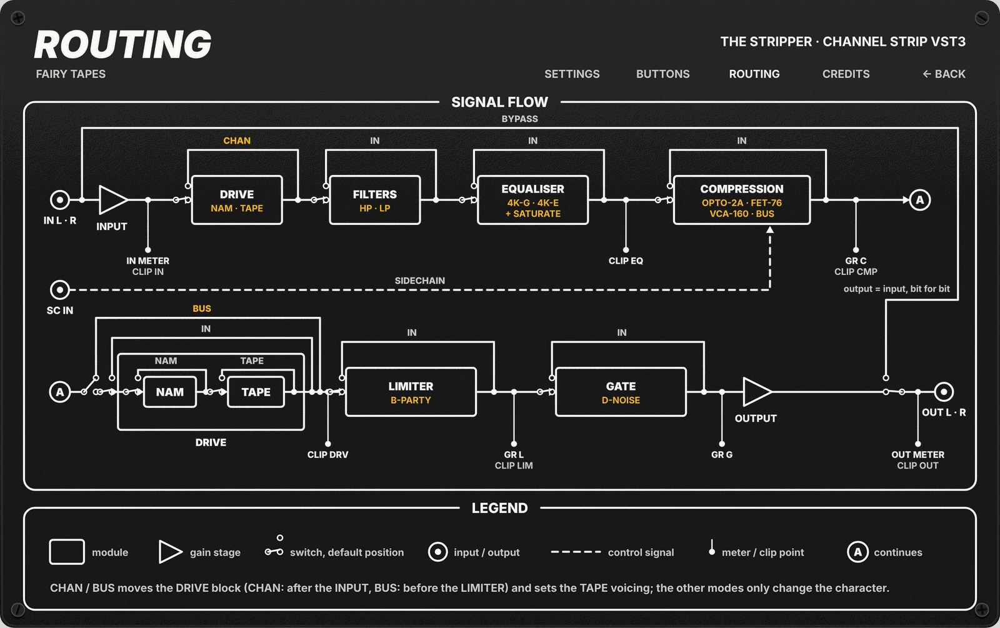

# Fairy Tapes · The Stripper

The Stripper is a VST3 channel strip with an analog voice. It chains filters, an SSL-style EQ, a compressor with four characters, a drive block with Neural Amp Modeler (NAM) and tape, a limiter and a gate. One switch, CHAN or BUS, sets the whole strip up for a single track or for a bus. Every module has its own IN button, so you can use only the parts you need.

**Status:** version 1 is complete in code. It has not yet been tested by hand in Reaper and Cubase or tried on Windows and macOS, and the optional CUDA (GPU) build is not verified.

## When to use it

The CHAN / BUS switch in the OUTPUT box picks one of two setups. It changes the character of the modules and the place of the Drive block. It never changes a knob value.

**CHAN (Channel): single tracks.** Vocals, drums, bass, guitars, keys.

- EQ with the 4K "Black" voicing (G series): tighter curves. LF and HF can be shelf or bell.
- Compressor with three characters: VOICE (opto), DRUMS (FET), CLASSIC (VCA).
- The Drive block comes right after the input, like a preamp and a multitrack tape machine in front of the console. TAPE uses the Tracking voicing: it hits harder and adds more head bump.

**BUS (Mix bus): groups and buses.** Drum bus, stems, subgroups, the mix bus.

- EQ with the 4K "Brown" voicing (E series): wider, softer curves. LF and HF are always shelves.
- The bus compressor only (the VOICE / DRUMS / CLASSIC buttons hide).
- The Drive block moves after the compressor, just before the limiter, like outboard gear and a 2-track mixdown machine. TAPE uses the Mixdown voicing: gentler slam and bump.

In both modes the compressor has a stereo sidechain input. Route a signal to it in your host (a kick to duck the bass, for example) and the compressor listens to that signal instead of the main one.

A new instance is not fully transparent: every module is in, TAPE is on (tape colour even at 0) and the limiter works at POUND 5.0. Switch off what you do not want.

## Signal flow



The same diagram is on the ROUTING tab of the back panel. In engine order:

1. **Input.** The input level meter reads the raw input. Then the input gain, -20 to +20 dB, and the IN clip LED.
2. **Drive, CHAN only at this point.** NAM, then TAPE, each with its own on/off switch. The Drive IN takes out both.
3. **Filters and EQ.** One 4K-EQ engine: high pass first, then the four bands (LF, LM, HM, HF), then the low pass. SATURATE adds the console saturation as the last step of the EQ. The filters follow only their own IN: with the EQ IN off and the FILTERS IN on, the high pass and low pass still work while the bands and SATURATE are out.
4. **Compression.** Amount and Mix, with the character set by CHAN / BUS and VOICE / DRUMS / CLASSIC. The sidechain input feeds the detector.
5. **Drive, BUS only at this point.** The same block as step 2.
6. **Limiter.** One knob, POUND.
7. **Gate.** One knob, THRESH.
8. **Output.** Output gain, -20 to +20 dB, then the output meter and the OUT clip LED.

BYPASS (in the OUTPUT box) sends the input to the output unchanged, bit for bit.

## Controls

Every control is a VST3 parameter, so the host can automate it and show it in its own list. The host name is in brackets when it differs from the panel label.

| Module | Control | Range | Default |
|---|---|---|---|
| INPUT | GAIN (Input Gain) | -20 to +20 dB | 0 dB |
| FILTERS | HIGH PASS (EQ HPF Freq) | 20 to 500 Hz | 20 Hz |
| FILTERS | LOW PASS (EQ LPF Freq) | 3 to 20 kHz | 20 kHz |
| FILTERS | IN (LP/HP Bypass, inverted) | in / out | in |
| EQUALISER | LF GAIN, FREQ | -20 to +20 dB; 30 to 480 Hz | 0 dB; 100 Hz |
| EQUALISER | LF bell button (EQ LF Bell) | shelf / bell (CHAN only) | shelf |
| EQUALISER | LM GAIN, FREQ, Q | -20 to +20 dB; 200 to 2500 Hz; 0.4 to 4 | 0 dB; 600 Hz; 0.7 |
| EQUALISER | HM GAIN, FREQ, Q | -20 to +20 dB; 600 to 7000 Hz; 0.4 to 4 | 0 dB; 2 kHz; 0.7 |
| EQUALISER | HF GAIN, FREQ | -20 to +20 dB; 1.5 to 16 kHz | 0 dB; 8 kHz |
| EQUALISER | HF bell button (EQ HF Bell) | shelf / bell (CHAN only) | shelf |
| EQUALISER | SATURATE (EQ Saturation) | 0 to 100 % | 0 % |
| EQUALISER | IN (EQ Bypass, inverted) | in / out | in |
| COMPRESSION | AMOUNT (Compress Amount) | 0 to 100 % | 0 % |
| COMPRESSION | MIX (Compress Mix) | dry to wet, 0 to 100 % | 100 % |
| COMPRESSION | VOICE / DRUMS / CLASSIC (Compressor Mode) | CHAN only; BUS always uses the bus compressor | VOICE |
| COMPRESSION | IN (Compression Bypass, inverted) | in / out | in |
| DRIVE | DRIVE (Drive) | 0 to 100 %: 0 to +20 dB into the NAM model | 0 % |
| DRIVE | NAM switch (Drive NAM) | on / off | on |
| DRIVE | TAPE knob (Tape) | 0 to 10 | 0 |
| DRIVE | TAPE switch (Drive Tape) | on / off | on |
| DRIVE | IN (Drive Bypass, inverted) | in / out | in |
| LIMITER | POUND (Limiter Pound) | 0 to 10 | 5.0 |
| LIMITER | IN (Limiter Bypass, inverted) | in / out | in |
| GATE | THRESH (Gate Threshold) | -inf (fully left, gate open) to about -48 dBFS (fully right) | fully left |
| GATE | IN (Gate Bypass, inverted) | in / out | in |
| OUTPUT | GAIN (Output Gain) | -20 to +20 dB | 0 dB |
| OUTPUT | CHAN / BUS (Strip Mode) | Channel / Mix bus | CHAN |
| OUTPUT | BYPASS | on / off | off |

Notes:

- The DRIVE and TAPE knobs change the colour, not the level. Both outputs are matched to their input level.
- The host list also shows a few parameters that have no panel control. **EQ HPF On** and **EQ LPF On** stay on (20 Hz and 20 kHz are neutral) and work if you automate them. **Gain Staging Bypass** and **Gain Staging Trim** do nothing: gain staging is not part of version 1.
- **Compressor Gain Reduction**, **Limiter Gain Reduction** and **Gate Gain Reduction** are read-only parameters for control surfaces such as SSL 360 Link (0 = no reduction, dB = 20·log10(1 - value)). The gate value is an estimate from the gate's input and output peaks.
- All 38 parameters, with their IDs: [docs/CONTROLS.md](docs/CONTROLS.md) (in Italian).

## Editor

- A 1000 × 628 rack panel, drawn by code. The host can scale the window.
- **IN buttons:** lit means the module is in the signal path. When a module is out, its controls dim.
- **Knobs:** double-click to go back to the default. Click the yellow value under a knob to type a value ("3", "+3.5 dB", "1.2k", "45 %"); Enter confirms, Esc cancels.
- **LEVEL box:** input and output peak meters (-60 to +6 dBFS), gain reduction for the compressor (C), the limiter (L) and the gate (G), and one clip LED per stage (IN, EQ, CMP, DRV, LIM, OUT). A clip LED stays lit for 2 s after the output of its stage reaches 0 dBFS. Click any clip LED to clear them all. The DRV LED follows the Drive block to wherever CHAN / BUS puts it.
- **Model strip:** the paper strip in the DRIVE box shows the loaded NAM model. Click it to open the model browser (see below).
- **Tape pieces:** click a piece of paper tape on the panel to write on it (up to 14 characters). The text is saved with the project.
- **Recall marks:** a blue pen mark shows where a knob was when the project was loaded (or when you pressed MARK NOW). It appears once the knob moves away. Alt + double-click (or Ctrl / Cmd + double-click) returns the knob to that mark.
- **Back panel:** click BACK → at the top right to flip the panel.
  - SETTINGS, Appearance (saved for you, in every project): wear, notes layer (tape and pen marks), tape font, values font, meter hold and release, RE-ROLL for new wear and dirt (it also clears the writing on the tape pieces).
  - SETTINGS, Behaviour (saved in the project): recall marks AUTO or MANUAL, MARK NOW, model folders. NAM INFERENCE (AUTO / GPU / CPU) is shown but not active yet.
  - BUTTONS explains what every button does and what it changes. ROUTING shows the signal flow. CREDITS lists the licences.
- Your appearance settings and model folders live in `FairyTapes/TheStripper.prefs` in your user settings folder (`~/.config` on Linux, `~/Library/Application Support` on macOS, `%APPDATA%` on Windows).

## NAM models

The Stripper ships with no models. You bring your own `.nam` files.

- **Where to get them:** download captures from the NAM community, for example on [TONE3000](https://www.tone3000.com), or train your own with the [NAM trainer](https://github.com/sdatkinson/neural-amp-modeler). A capture can be a preamp, a pedal, a piece of outboard or a tape machine. Each model has its own licence: check it before you share a project or a render.
- **How to load:** click the model strip in the DRIVE box. The model browser opens. Add the folders where you keep your models with **+ ADD**; they are scanned with all their subfolders. Pick a model (you can search by name) and press **LOAD**. Until you edit the folder list, the browser offers `~/NAM`, `~/Documents/NAM` and `~/Documents/Tone3000` if they exist. There is no online search or download in version 1.
- **Loading** runs on a separate thread: the audio does not stop. The model path is saved with the project and loaded again when you open it. If the file is missing or cannot be read, the strip shows the error and NAM passes the signal through.
- **No model:** with no model loaded (or after **NO MODEL** in the browser), NAM passes the signal through unchanged. TAPE still works.
- **Stereo:** NAM runs as dual mono, one instance of the model for each channel, in CHAN and in BUS, so the stereo image is kept. Both instances always run while a model is loaded, also on a mono source: the CPU load is constant and does not jump when the material changes, at twice the cost of one instance. The level compensation is linked (one gain for both channels).
- **Sample rate:** the model runs at the session rate, with no resampling. NAM models are normally trained at 48 kHz, so a 48 kHz session gives the sound of the capture.
- **CPU and GPU:** NAM runs on the CPU (NeuralAmpModelerCore), and each instance with a model has a real CPU cost. There is an optional GPU path for NVIDIA cards (custom CUDA kernels in `shared/gpu_nam`, WaveNet models only). It is built only when the CUDA toolkit is present at build time and has not been verified yet. When the GPU cannot take a model, the model runs on the CPU.

## Install and build

**Pre-built binaries:** see the GitHub Releases of the repository ([root README](../../README.md)). Copy the whole `TheStripper.vst3` bundle into your VST3 folder:

- Linux: `~/.vst3`
- Windows: `C:\Program Files\Common Files\VST3`
- macOS: `~/Library/Audio/Plug-Ins/VST3` or `/Library/Audio/Plug-Ins/VST3`

Then rescan plug-ins in your host and look for "The Stripper".

**Build from source.** You need CMake 3.25 or newer and a C++20 compiler. On Linux, VSTGUI also needs the X11, Cairo, Pango, fontconfig and xcb development packages (the list is in `.github/workflows/build.yml`).

1. Get the sources with their submodules (VST 3 SDK, NeuralAmpModelerCore), as described in [Getting the sources](../../README.md#getting-the-sources):

   ```bash
   git clone --recurse-submodules https://github.com/sweetspot-tools/fairy-tapes.git
   cd fairy-tapes
   ```

2. Configure in a build folder outside the repository, then build the plug-in and its tests:

   ```bash
   cmake -S . -B ../fairy-tapes-build -DCMAKE_BUILD_TYPE=Release -DGPU_NAM_DISABLE_CUDA=ON
   cmake --build ../fairy-tapes-build --config Release --target the_stripper the_stripper_tests -j2
   ctest --test-dir ../fairy-tapes-build -C Release -R the_stripper_tests --output-on-failure
   ```

3. The bundle is written to `dist/TheStripper.vst3` in the repository root. Copy it to your VST3 folder as above.

Notes:

- Build only the targets you need: a build of the whole suite takes a lot of memory. `-j2` keeps it safe on small machines.
- `-DGPU_NAM_DISABLE_CUDA=ON` builds the CPU-only version. To try the GPU path, leave it out on a machine with the CUDA toolkit and an NVIDIA driver (not verified yet).
- Configure from the repository root, not from this folder: the plug-in needs the shared libraries (`shared/`) and the SDK targets that the root `CMakeLists.txt` sets up.

## Third-party code and licences

The Stripper is released under the GNU GPL v3.0, like the whole suite. Each ported file starts with a header that names its origin. Full list for the suite, with pinned commits: [THIRD_PARTY.md](../../THIRD_PARTY.md).

| Component | Author | Licence | Used for | In this repository |
|---|---|---|---|---|
| 4K-EQ (filters, bands, `SSLSaturation`) | Dusk Audio (formerly Luna Co. Audio) | GPL-3.0 | filters, EQ, SATURATE | `src/dsp/fourk_eq.*`, `src/dsp/biquad.h`, `src/dsp/ssl_saturation.h` |
| Multi-Comp (Opto, FET, VCA and Bus engines, hardware emulation) | Dusk Audio | GPL-3.0 | compression | `src/dsp/multicomp_engines.*`, `src/dsp/hardware_emulation/`, `src/dsp/compression_stub.*` |
| Tape | Chris Johnson (Airwindows) | MIT | TAPE in the Drive block | `src/dsp/tape_saturation.*` |
| BlockParty | Chris Johnson (Airwindows) | MIT | limiter | `src/dsp/blockparty.*` |
| DeNoise | Chris Johnson (Airwindows) | MIT | gate | `src/dsp/denoise.*` |
| NeuralAmpModelerCore, AudioDSPTools | Steven Atkinson | MIT | NAM in the Drive block | submodule `vendors/NeuralAmpModelerCore`, wrapped by `shared/nam_drive` |
| Eigen | Eigen contributors | MPL-2.0 | NAM dependency | inside the NAM submodule |
| nlohmann/json | Niels Lohmann | MIT | reading `.nam` files | inside the NAM submodule |
| VST 3 SDK | Steinberg Media Technologies | MIT | plug-in format | submodule `vendors/vst3sdk` |
| VSTGUI | Steinberg Media Technologies | BSD-3-Clause | editor | inside the VST 3 SDK |
| Zeyada | Kimberly Geswein | OFL-1.1 | tape font | outlines in `shared/ui` |
| Rock Salt, Homemade Apple | Font Diner | Apache-2.0 | tape fonts | outlines in `shared/ui` |

The CUDA kernels of the optional GPU path (`shared/gpu_nam`) are our own code. VST is a trademark of Steinberg Media Technologies GmbH.

## Documents

Design documents are mostly in Italian.

- Design spec: [2026-10-09-the-stripper-completion-design.md](../../docs/superpowers/specs/2026-10-09-the-stripper-completion-design.md) (open decisions in §11)
- Implementation plan and status: [2026-10-09-the-stripper-completion.md](../../docs/superpowers/plans/2026-10-09-the-stripper-completion.md)
- HTML preview of the panel: [docs/mockups/stripper_rack.html](docs/mockups/stripper_rack.html), plus the model browser ([stripper_model_browser.html](docs/mockups/stripper_model_browser.html)) and the control materials ([stripper_controls_lab.html](docs/mockups/stripper_controls_lab.html)). Open them from a local web server rooted in the repository.
- [docs/OVERVIEW.md](docs/OVERVIEW.md): one-page summary of the stage choices.
- [docs/FEATURES.md](docs/FEATURES.md): requirements and the research behind each choice (with the rejected candidates), SSL 360 Link notes.
- [docs/CONTROLS.md](docs/CONTROLS.md): every parameter with its ID.
- [docs/COMPRESSION_MODES.md](docs/COMPRESSION_MODES.md): the compressor characters and the sidechain.
- [docs/DRIVE_STAGE_PARAMS.md](docs/DRIVE_STAGE_PARAMS.md): the Drive block (NAM and TAPE) in detail.
- [docs/BUILD_AND_USE.md](docs/BUILD_AND_USE.md): build, install in Reaper, developer tools.
- GPU path: [shared/gpu_nam/docs/GPU_NAM_ARCHITECTURE.md](../../shared/gpu_nam/docs/GPU_NAM_ARCHITECTURE.md)
- Visual rules shared by the suite: [docs/DESIGN_SYSTEM.md](../../docs/DESIGN_SYSTEM.md)
